# HongGuo — 红果短剧 Mac 客户端

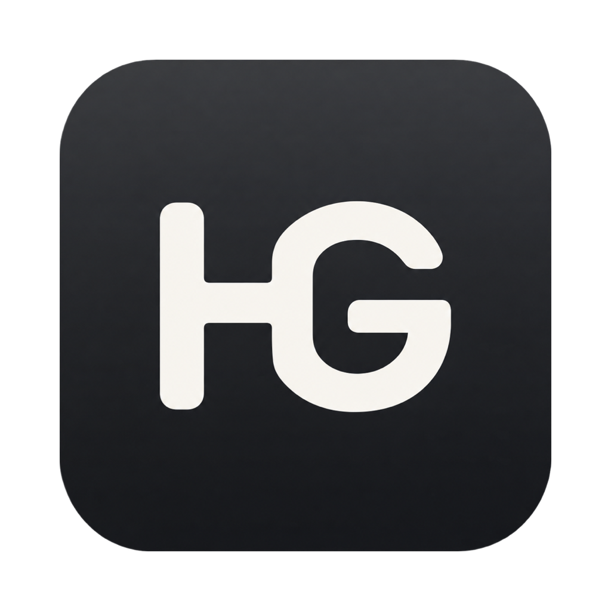

HongGuo 是面向 macOS 的红果短剧客户端，支持 Apple Silicon（M 系列）Mac。使用原生 SwiftUI 界面，提供经典、映幕、青序三套深浅主题，支持独立播放、离线下载、MP4 导出、收藏续播与本机追更。

**[⬇ 下载 Mac 安装包](https://github.com/junmo-zy/hongguo-mac/releases/download/v0.8.1/HongGuo-Mac-0.8.1-arm64.dmg)**　｜　[三步安装](#三步安装)　｜　[安装说明](#安装说明)　｜　[全部版本](https://github.com/junmo-zy/hongguo-mac/releases)

**macOS 14+ · Apple Silicon（M 系列）· v0.8.1 · 155.0 MiB**。点击上方直接下载 `.dmg`，无需进入 Releases 查找文件，也不用下载 `Source code` 压缩包。

## 版本与系统要求

| 项目 | 说明 |
| --- | --- |
| 当前版本 | v0.8.1 |
| 系统 | macOS 14 或更新版本 |
| 芯片 | Apple Silicon，M 系列芯片；目前不支持 Intel Mac |
| 安装包 | `HongGuo-Mac-0.8.1-arm64.dmg`，约 155.0 MiB |
| 运行环境 | 已内置 Python、Java 及所需组件，无需自行配置 |
| 手机依赖 | 不需要连接手机或运行安卓模拟器 |
| 网络 | 浏览、在线播放与下载需要联网；已完成的下载可离线播放 |
| 签名 | 临时签名，尚未经过 Apple 公证 |

本仓库用于分发安装包、说明和截图，不是完整源码仓库，也不在仓库中托管剧集文件。

## 0.8.1 更新 · 播放源修复

- **恢复播放与下载**：修复旧播放接口返回空响应、无法获取视频的问题，更新在线播放和离线下载共用的取流请求。
- **保留最高可用画质**：实测恢复 1080p 播放，清晰度切换、切集、预加载、续播及下载继续可用；实际可选画质以每集片源为准。
- **保留界面与数据**：经典、映幕、青序三套深浅主题、SwiftUI 原生结构，以及本机收藏、观看记录和播放偏好保持原样。

[查看 0.8.1 发布说明](https://github.com/junmo-zy/hongguo-mac/releases/tag/v0.8.1)

### 0.8.0 功能更新

- **三套主题**：保留经典，新增映幕与青序。首页、剧集卡片、详情页和播放器保持原生 SwiftUI 结构；每套主题均支持浅色、深色和跟随系统。
- **离线下载与导出**：按集数范围和清晰度下载，支持暂停、继续、失败重试、保存位置迁移和索引修复；已下载集数可分别导出 MP4 或按顺序无损合并。
- **更完整的播放控制**：独立预加载开关、竖屏小窗、长按右方向键临时 2 倍速、暂停并隐藏、画面适应方式、播放防休眠与 H.264 / AAC 兼容播放。
- **找剧与追更**：支持官网链接或剧集 ID、演员搜索、其他季候选、本机追更、推荐换一批和只读本集评论；应用内可检查 GitHub 正式版更新。

[查看 0.8.0 发布说明](https://github.com/junmo-zy/hongguo-mac/releases/tag/v0.8.0)

## 界面截图

以下 12 张截图均于 2026-10-12 从 0.8.0 原生应用拍摄，使用独立演示数据；0.8.1 沿用相同界面。片单、封面与画面会随内容服务变化。

### 映幕 · 海报卡片与柔和层次

| 浅色 | 深色 |
| --- | --- |
|  | 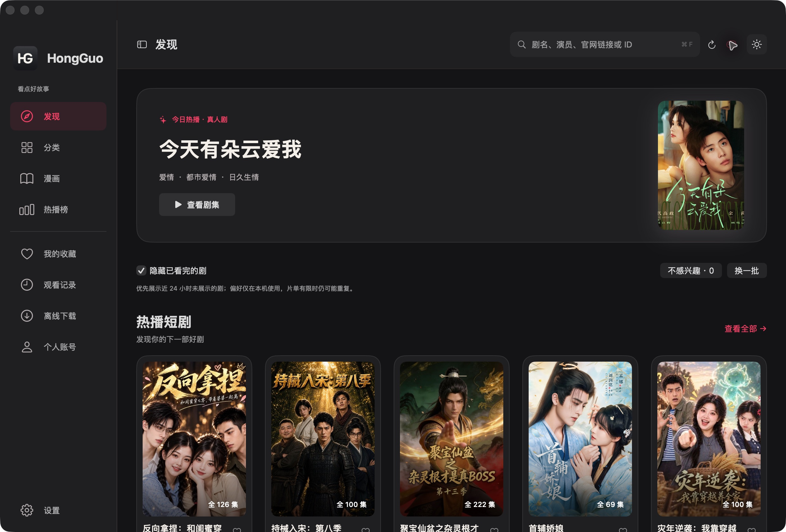 |

### 青序 · 青绿纸白与横向片单

| 浅色 | 深色 |
| --- | --- |
| 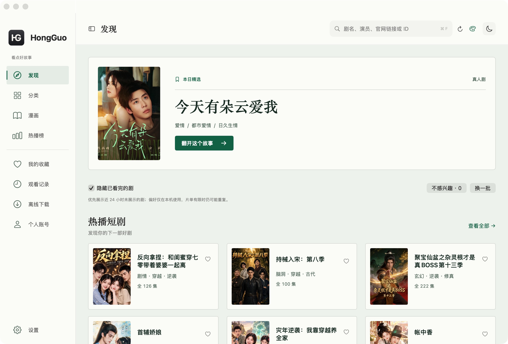 | 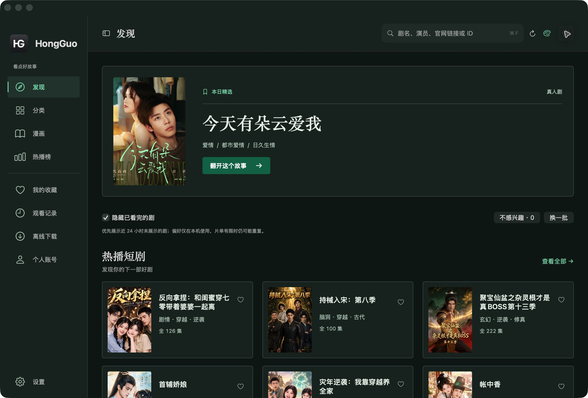 |

### 经典 · 保留熟悉的布局

| 浅色 | 深色 |
| --- | --- |
| 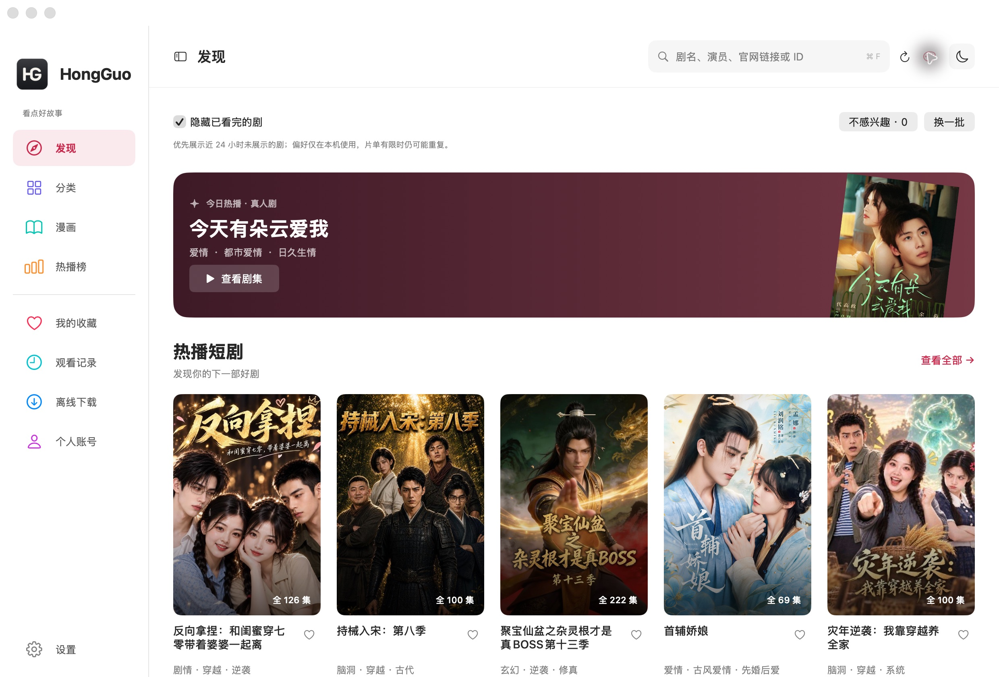 | 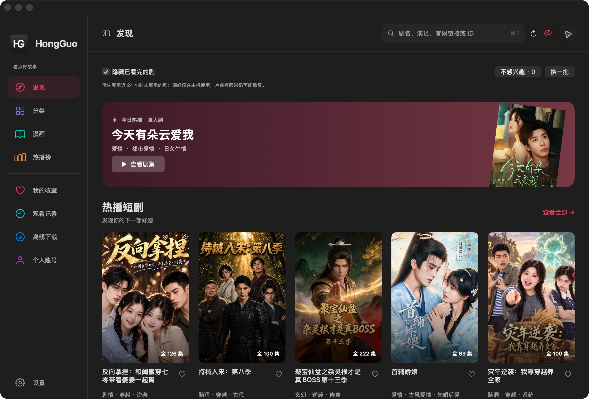 |

### 剧集详情与分组选集

| 映幕 · 深色 | 青序 · 浅色 |
| --- | --- |
| 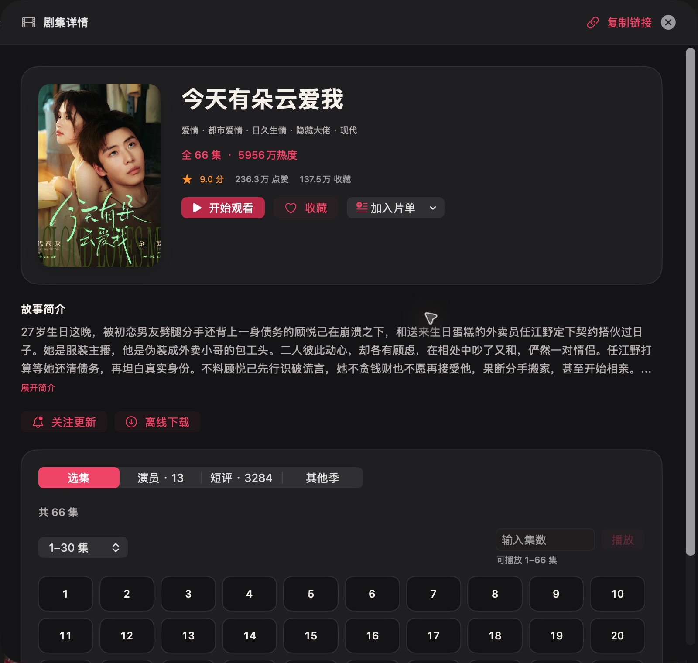 | 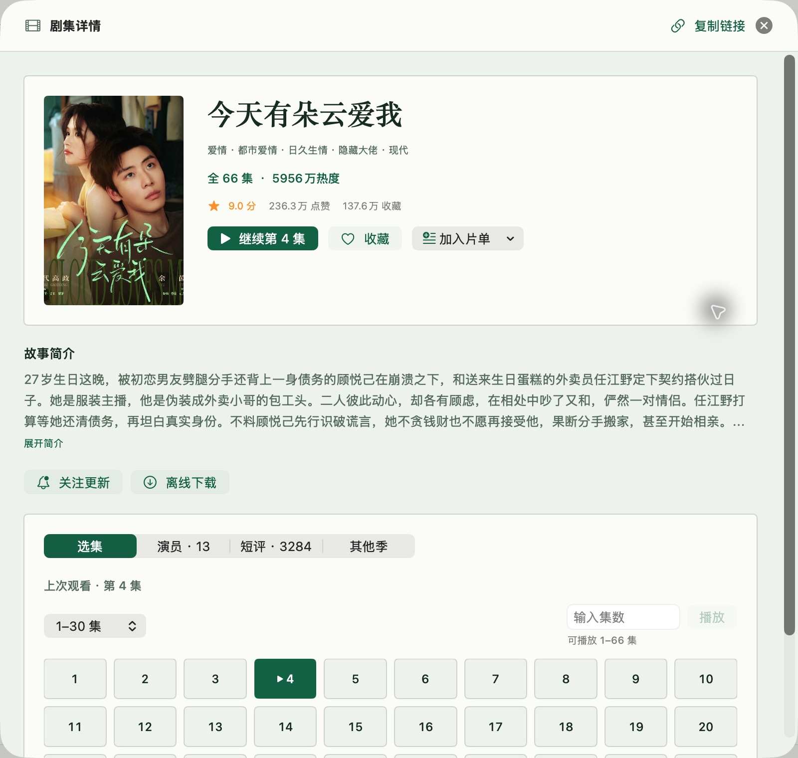 |

### 独立播放器

| 映幕 · 深色 | 青序 · 浅色 |
| --- | --- |
| 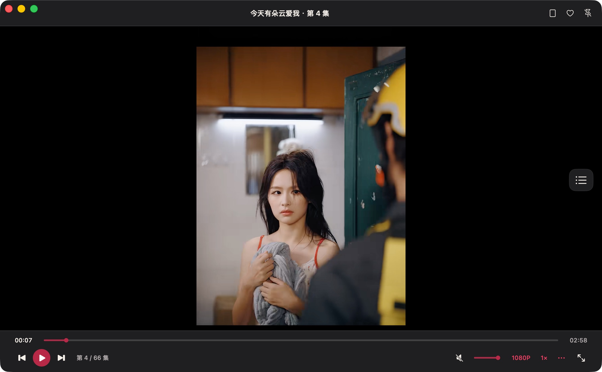 | 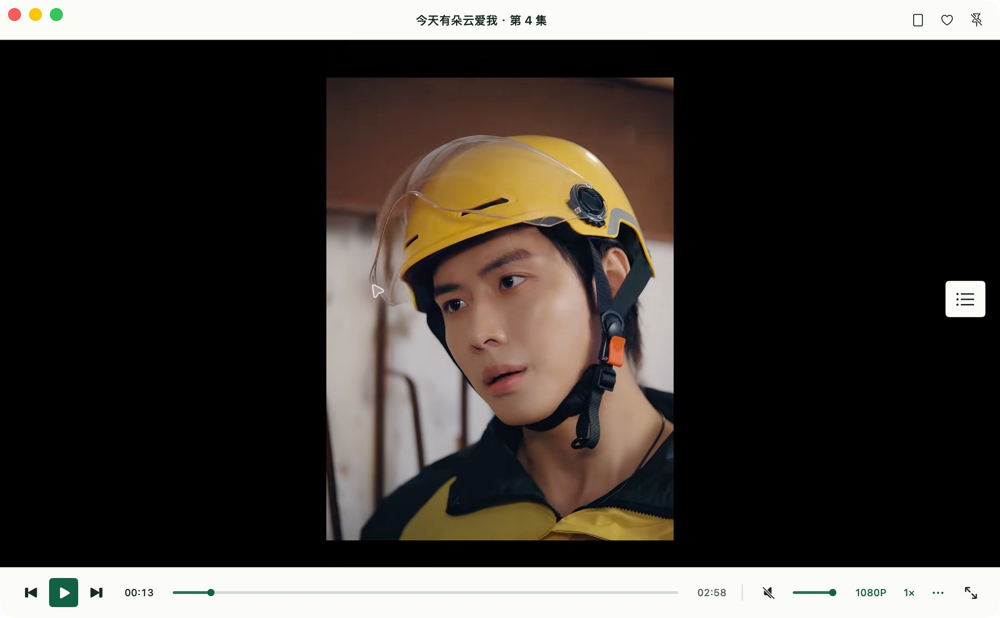 |

映幕、青序的播放控件随深浅外观切换，视频画布始终保持黑色。

### 分类筛选与离线选集

| 分类 · 映幕深色 | 范围下载 · 青序浅色 |
| --- | --- |
| 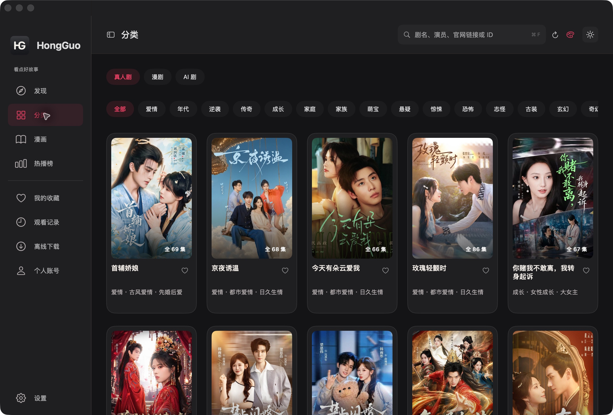 | 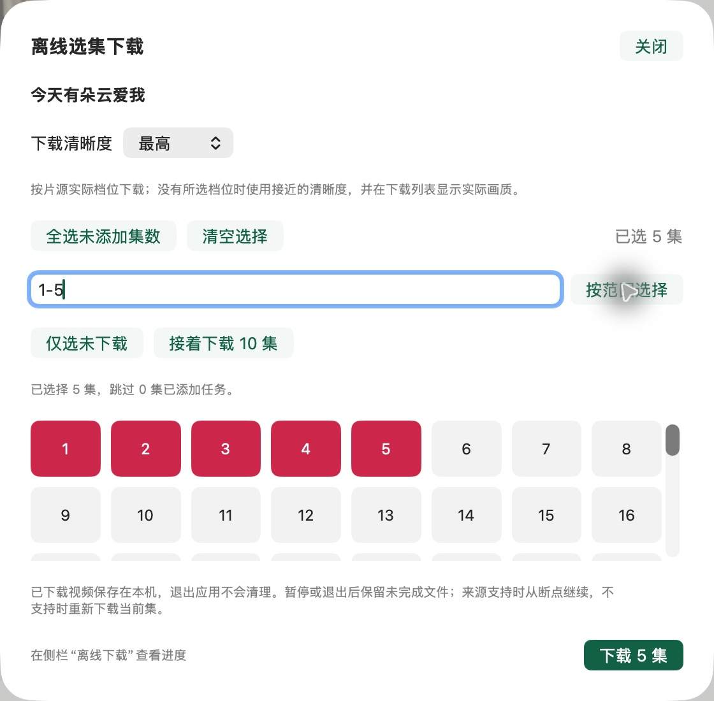 |

## 功能一览

| 场景 | 当前支持 |
| --- | --- |
| 发现内容 | 发现页、分类、真人剧 / 漫剧 / AI 剧筛选、热播榜 |
| 搜索 | 剧名、演员、官网详情 / 播放链接、剧集 ID、最近搜索与来源支持的分页 |
| 查看详情 | 剧情简介、演员资料与短评、分组选集、其他季候选、复制链接 |
| 独立播放 | 上一集 / 下一集、自动连播、独立预加载开关、续播、竖屏小窗与集数跳转 |
| 画质 | 默认选择片源提供的最高可用清晰度，支持手动切换，切换时保留进度 |
| 播放控制 | 点击暂停、进度、音量 / 静音、全屏、置顶、定时停止、暂停并隐藏、长按临时倍速 |
| 倍速 | 0.75×、1×、1.25×、1.5×、2×；选择后自动保存 |
| 快进快退 | 方向键操作；步长可选 5、10、15、30、60 秒 |
| 播放偏好 | 倍速、音量、静音、快进步长和自动连播设置保存在本机 |
| 收藏与记录 | 我的收藏、想看 / 在看 / 已看状态、观看记录、续播、收藏筛选与排序 |
| 备份 | 收藏、观看记录、追更、推荐偏好与漫画进度支持 JSON 导出、导入合并；不含视频文件 |
| 漫画 | 漫画列表、公开章节阅读、本机阅读进度 |
| 外观 | 经典 / 映幕 / 青序三套主题，均支持浅色、深色和跟随系统 |
| 个性化 | 自定义名称和图标、恢复默认、生成定制 App |
| 离线下载 | 范围选集、画质选择、暂停 / 继续、断点续传、失败重试、迁移、扫描与索引修复 |
| 视频导出 | 所选已下载集数分别导出 MP4，或按集数无损合并；保留原文件 |
| 本机追更 | 关注新增集数与疑似新季、手动检查、可选系统通知 |
| 故障恢复 | 失败切集回退、重试、重启播放组件、H.264 / AAC 兼容转码和本次运行诊断 |
| 更新检查 | 提示本项目 GitHub 新正式版，可关闭或忽略；不自动下载安装 |

播放中约 1.5 秒无操作后隐藏控制栏；暂停、加载、选集或拖动时保留操作入口。经典播放器保持深色；映幕、青序的控件随外观变化，视频画布始终黑色。画中画是否可用取决于片源与 WebKit 支持。

## 三步安装

1. **下载**：[点击下载 HongGuo Mac 安装包](https://github.com/junmo-zy/hongguo-mac/releases/download/v0.8.1/HongGuo-Mac-0.8.1-arm64.dmg)。
2. **安装**：打开 `.dmg`，把 **HongGuo.app** 拖入 **Applications / 应用程序**。已有旧版时，先完全退出，再选择替换。
3. **启动**：从「应用程序」打开 **HongGuo**。

## 安装说明

当前安装包仅支持 **macOS 14+、Apple Silicon（M 系列芯片）**，不支持 Intel Mac。无需另装 Python、Java 或安卓模拟器。Release 自动生成的 `Source code` 压缩包不是 Mac 安装包。

旧版名称若仍是「红果短剧.app」，先将旧 App 改名为「HongGuo.app」再替换，避免保留两个入口。替换应用会沿用本机收藏、观看记录和播放偏好；重要数据可先在「设置 → 我的数据」导出备份。

如果 macOS 阻止打开，请先核对下载来源，再在「系统设置 → 隐私与安全性」使用系统提供的「仍要打开」入口。无需关闭系统安全防护。

## 常用操作

| 操作 | 快捷键 / 入口 |
| --- | --- |
| 搜索 | `⌘ F` |
| 播放 / 暂停 | 单击视频、空格或 `⌘ P` |
| 快退 / 快进 | `←` / `→`，也支持 `⌘ ←` / `⌘ →` |
| 增加 / 减少音量 | `↑` / `↓`，每次 5% |
| 静音 / 恢复声音 | `⇧ ⌘ M` |
| 全屏 / 退出全屏 | 播放器全屏按钮或 `⌃ ⌘ F` |
| 快进步长 | 设置 → 观看偏好，或播放器「更多」 |
| 清晰度 | 播放器底部清晰度菜单 |
| 倍速 | 播放器底部倍速菜单；设置内也可指定默认速度 |
| 选集 | 播放器右侧列表按钮，或剧集详情的选集区域 |
| 外观 / 主题 | 右上角太阳 / 月亮、调色板按钮，或设置 → 外观 |
| 暂停并隐藏 | `⌘ B` |
| 临时 2 倍速 | 播放时长按右方向键，松开恢复原倍速 |
| 离线下载 | 详情页 → 离线下载；侧栏管理任务 |
| 备份 | 设置 → 我的数据 → 导出备份 / 导入 |

方向键在播放窗口内生效；输入集数时保留正常的文字编辑行为。完整快捷操作也可在「设置 → 快捷操作」查看。

## 自定义名称与图标

打开 **设置 → 名称与图标**：

1. 输入 1–24 个字符的名称。
2. 选择 PNG、JPEG 或 ICNS 图标，文件不超过 20 MB。
3. 点击「保存」。界面名称、窗口标题和运行中的 Dock 图标立即更新，重启后仍会保留。
4. 「默认图标」可重新选用 HG 图标；「恢复默认」会恢复 HongGuo 名称及默认图标。

若需要 **Finder 和 Dock 显示的应用名称**一起改变，点击「生成定制 App…」，选择一个尚未使用的保存位置。成功后退出原 App，从新 App 启动，再将新 App 移入 Applications。定制 App 携带所选名称与图标，并沿用原来的收藏、记录与播放偏好；不会覆盖已有应用或改写正在运行的 App。

Dock 若固定了旧入口，请移除旧入口并固定新 App。安装后续发行包后，可再次生成定制 App。自定义名称或图标不会改变第三方内容的权利与许可。

## 数据与账号

收藏、观看记录、漫画进度、追更与偏好保存在本机。备份导入会合并收藏和记录，并尽量保留较新的观看进度。离线视频单独保存在下载目录，不包含在 JSON 备份中。

**目前尚未接入红果账号登录和手机云同步。** 「个人账号」入口不表示已经实现官方账号体系。评论发布、官方账号关注与会员体系尚未接入。本机“关注更新”只保存本地追更状态。详情短评和本集评论为只读，来源可能只提供数量而没有正文；应用会显示实际限制。

## 常见问题

**为什么某一集播放失败或加载较慢？**

片源、网络和第三方服务的可用性会变化。可重试当前集，或尝试其他可用清晰度。默认最高画质可能需要更多带宽；本项目不承诺所有剧集始终可播。

**为什么最高画质不是固定 1080P / 4K？**

“最高”指当前片源提供的最高可用档位。不同剧集可选档位可能不同，不会把低分辨率画面标成更高画质。

**搜索内容不全怎么办？**

搜索接口不可用时会回退到官网首批结果，此时搜索范围和分页能力可能受限。可以尝试缩短关键词，或从分类与热播榜查找。

**更新后收藏会丢失吗？**

正常替换 App 会保留本机数据。更新前可先导出收藏与记录备份；若迁移到另一台 Mac，可再导入。备份不包含剧集视频或官方账号信息。

**为什么 Dock 仍显示旧名称或旧图标？**

先退出旧 App，再从新 App 启动；若 Dock 固定的是旧文件，移除旧入口后重新固定。只修改界面名称时，Finder 文件名不会跟着改变，需要使用「生成定制 App」。

**是否支持 Intel Mac、Windows 或离线观看？**

这个发行包仅面向 Apple Silicon Mac，不支持 Intel 或 Windows。已下载完成的视频支持离线播放；普通收藏或历史入口仍可联网，离线观看请使用“离线下载”中的播放入口。

## 下载、导出与追更说明

- 在详情页选择下载清晰度和集数，可输入 `1-20,25,30-40`。暂停或退出会保留当前集的未完成文件；来源支持时续传，不支持或文件变化时重新下载。重启后手动继续队列。
- 保存位置迁移会先复制再切换，原目录保留为备份。索引修复和目录扫描用于恢复保留的本地视频记录。
- 导出需选择同一部剧的已完成集数，每集只选一个清晰度。无损合并按集数排序；不同编码无法直接合并时，可分别导出 MP4。
- 兼容播放将当前集转为 H.264 / AAC，不改原下载文件；转码可取消，临时副本在关闭播放器后清理。无法修复损坏或缺失的源文件。
- 追更仅在应用运行时检查。其他季按剧名匹配，可能遗漏或误匹配；开启系统通知为可选项。

## 验证与已知限制

0.8.1 于 2026-10-17 在 Apple Silicon / macOS 26.6.2 上通过四组自动化回归，覆盖真实 1080p 在线播放、清晰度切换与切集、预加载和续播、并行播放与下载、离线播放、MP4 导出与合并、失败切集回退、兼容转码、画面模式、防休眠及播放偏好。新增接口测试覆盖批量请求、缓存、异常响应和剧集匹配；安装包签名、镜像完整性及安装启动检查通过。三套主题深浅设置页的原生渲染与滚动沿用 0.8.0 的验证结果。

AirPlay 的配置、接口与调用链已验证；系统设备选择器实际显示和接收端投放尚未完成确认。尚未完成其他 macOS 版本及长时间耐久测试。片源、画质、搜索范围和评论正文取决于第三方服务。

## 项目来源与反馈

Mac 界面使用 SwiftUI + WebKit。桌面播放方案参考 [hongguo-desktop-releases](https://github.com/waligoraamodio288-rgb/hongguo-desktop-releases)，后端来源为其公开发行组件及 [zhangbaio/hongguo](https://github.com/zhangbaio/hongguo)。组件来源说明与原有许可证保留在应用包的 `Contents/Resources/Backend/PROVENANCE.md`、`Backend/licenses` 及运行环境目录中。本项目不重新许可第三方组件或内容。

0.8.1 的取流请求字段参考 [hongguoTV 的近期播放修复](https://github.com/bimoshuxinghe/hongguoTV/commit/0815d5ec47ddab1353f85c85167b0ac47ef92ae9)，在本项目中独立实现 Python 适配，复用现有播放与下载流程。

遇到问题请在 [Issues](https://github.com/junmo-zy/hongguo-mac/issues) 提供 macOS 版本、芯片型号、应用版本、复现步骤和错误提示。播放问题可附剧名及集数；截图请避开个人信息，无需提交密码、验证码或账号凭证。

权利人反馈与处理方式请见 [免责声明与权利说明](DISCLAIMER.md)。
